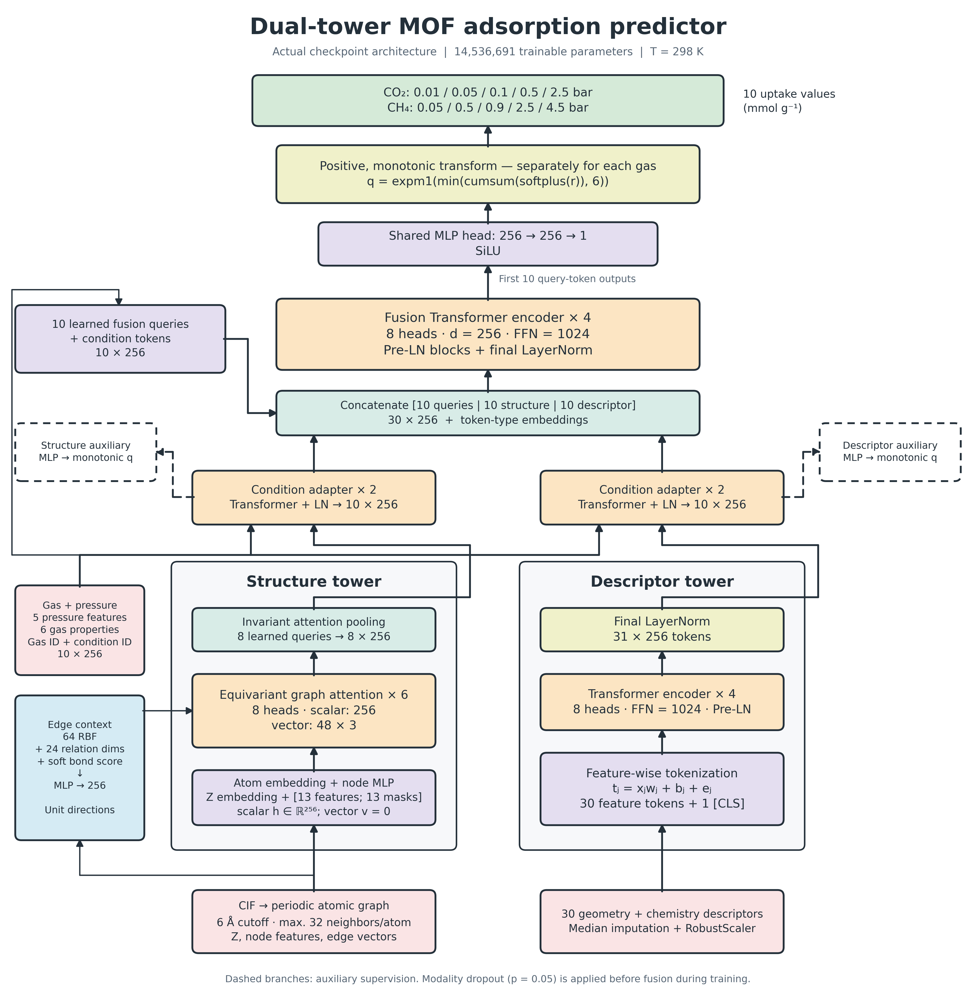
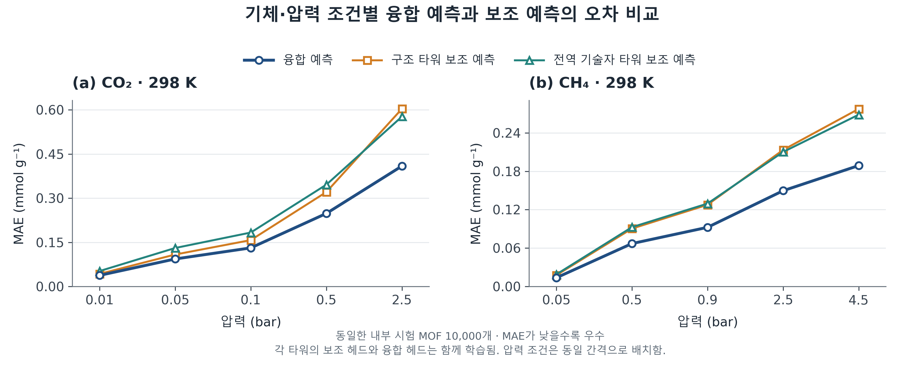
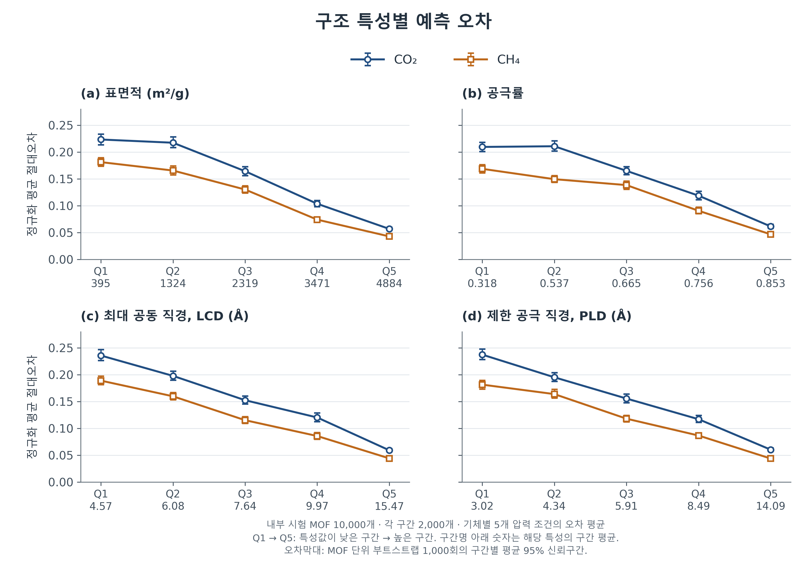

# Bi-transformer-for-MOF

**MOF의 원자 구조와 전역 기하·물리화학 기술자를 결합한 CO₂·CH₄ 흡착량 예측 연구.**

Periodic equivariant graph attention + descriptor Transformer + gas/pressure-conditioned fusion.

298 K에서 두 기체의 순수 성분 GCMC 흡착량을 각 5개 압력 조건에서 예측합니다.
최종 모델은 **14,536,691개 학습 파라미터**를 가지며, CPU 추론 앱·학습 파이프라인·평가 결과·논문용 그림을 함께 제공합니다.



## 공개 범위와 서버 기반 앱

이 저장소는 **가중치 없는 새 공개 이력**입니다. 학습·전처리 코드, 고정 분할 ID, 평가 기록과 예제는 공개하지만 학습된 PyTorch/ONNX 가중치는 공개하지 않습니다. 해시는 `server/model_manifest.json`에 기록합니다. 가중치를 보유하지 않은 독자는 저장된 평가·그림 및 방법을 검토할 수 있지만 동결 모델 추론을 그대로 실행할 수는 없습니다.

브라우저는 CIF와 네 기술자만 서버로 보내고 예측 수치만 받습니다. 신경망 계산과 CIF 전처리는 서버에서 수행하며 브라우저에 모델을 내려주지 않습니다. 20개 예제, 사용자 CIF 업로드, 기술자 직접 수정, GCMC 기준값 비교, 순차 예측의 모든 결과 다시 보기를 지원합니다. 기준값과 다른 기술자로 예측한 경우 정확도 비교를 표시하지 않습니다.

## 빠른 실행: 비공개 모델을 가진 운영자

Python 3.11 환경에서 다음을 실행합니다. 모델 파일은 공개 저장소 밖에 준비해야 합니다.

```bash
git clone https://github.com/jihojack/Bi-transformer-for-MOF-.git
cd Bi-transformer-for-MOF-
python -m venv .venv
```

PowerShell에서 가상환경을 활성화한 뒤:

```powershell
python -m pip install -r requirements-server.txt
$env:MOF_MODEL_PATH='D:\private-models\mof_fusion.onnx'
python -m server.app
```

Linux에서는 `export MOF_MODEL_PATH=/private/model.onnx`로 지정합니다. 로컬 주소는 `http://127.0.0.1:7866`입니다. 공개 서버 배포는 Gunicorn을 사용하며, **클라우드 서비스와 비공개 모델 공급 경로 설정이 추가로 필요합니다**. [서버/Netlify 배포 방법](docs/deployment.md)

입력은 **CIF + 표면적(m²/g), 공극률(0–1), LCD(Å), PLD(Å)**입니다. 학습 때와 같은 정의의 값을 사용해야 하며 모르는 값을 0으로 채우면 안 됩니다. 원격 서버 사용 시 입력은 해당 서버로 전송됩니다. 기본 원자 수 상한은 200개입니다.

## 데이터와 분할

| 항목 | 구성 |
|---|---|
| 데이터 | MOFX-DB의 hMOF 계열 구조 및 GCMC 흡착량 |
| 원래 데이터 구성 | 50,000 MOFs |
| 학습 / 검증 / 내부 시험 | 35,000 / 5,000 / 10,000 MOFs |
| 추가 평가 | 원래 50K 전체를 제외한 나머지에서 비복원 무작위 추출한 10,000 MOFs |
| 온도·출력 단위 | 298 K · mmol g⁻¹ |
| CO₂ 압력 | 0.01, 0.05, 0.1, 0.5, 2.5 bar |
| CH₄ 압력 | 0.05, 0.5, 0.9, 2.5, 4.5 bar |

세 내부 분할 간 교집합은 모두 0개이며, 추가 10K도 기존 50K와 ID 중복이 없습니다.
원래 50K는 층화 분할이고 추가 10K는 별도의 무작위 표본입니다.
둘 다 같은 데이터베이스의 표본이므로 다른 DB나 실험 MOF에 대한 OOD 검증으로 해석하지 않습니다.
[분할과 평가 프로토콜](docs/evaluation.md) · [데이터 준비](data/README.md)

## 모델

| 구성 요소 | 주요 설정 |
|---|---|
| 구조 타워 | 원자 임베딩 + 노드 특성, 6층 등변성 그래프 어텐션, 학습형 풀링 8개 |
| 전역 기술자 타워 | 기하·물리화학 기술자 30개 + CLS, 4층 Transformer |
| 공통 차원 | scalar 256, vector 48 × 3, attention 8 heads |
| 조건 적응 | 기체·압력 조건과 각 타워 토큰 결합, 타워별 2층 Transformer |
| 융합 | 질의 10개 + 구조 조건 토큰 10개 + 기술자 조건 토큰 10개, 4층 Transformer |
| 출력 | 공유 MLP와 기체별 누적 Softplus 변환으로 단조 비감소 곡선 생성 |

학습 코드의 실제 구현은 Pre-LN Transformer입니다. 두 타워는 독립 학습 후 앙상블한 것이 아니라 보조 헤드와 융합 헤드를 함께 학습합니다.
[아키텍처 상세](docs/architecture.md) · [블록 내부 연산 그림](figures/architecture/mof_architecture_module_details.png)

## 평가 결과

### 내부 시험 10,000개: 융합 예측

| 기체 | 압력 (bar) | R² | RMSE | MAE |
|---|---:|---:|---:|---:|
| CO₂ | 0.01 | 0.8725 | 0.0932 | 0.0376 |
| CO₂ | 0.05 | 0.9070 | 0.1824 | 0.0934 |
| CO₂ | 0.10 | 0.9198 | 0.2372 | 0.1310 |
| CO₂ | 0.50 | 0.9411 | 0.3934 | 0.2481 |
| CO₂ | 2.50 | 0.9481 | 0.6003 | 0.4093 |
| CH₄ | 0.05 | 0.9293 | 0.0360 | 0.0135 |
| CH₄ | 0.50 | 0.9533 | 0.1260 | 0.0670 |
| CH₄ | 0.90 | 0.9572 | 0.1617 | 0.0924 |
| CH₄ | 2.50 | 0.9620 | 0.2326 | 0.1496 |
| CH₄ | 4.50 | 0.9637 | 0.2793 | 0.1890 |

RMSE·MAE 단위: mmol g⁻¹. 원본: [test_metrics_all_towers.csv](results/internal/test_metrics_all_towers.csv).
학습에 사용한 10K가 아니라 **학습과 분리한 시험 10K**의 결과입니다.

### 융합 및 구조별 분석



융합 예측은 모든 조건에서 두 타워의 보조 예측보다 낮은 MAE를 보였습니다.
MOF 단위 부트스트랩의 MAE 감소량 95% 신뢰구간도 20개 비교 모두에서 0보다 컸습니다.
이는 이 시험 세트에서의 개선을 뒷받침하지만, 동일 용량의 독립 단일 타워 대비 비교 또는 비선형 상호작용 기전의 입증은 아닙니다.



구조 특성을 각각 2,000개씩 5개 구간으로 나누면 표면적·공극률·공극 직경이 작은 집단에서 정규화 오차가 더 큰 경향이 나타났습니다.
이는 기술자들 사이의 상관이나 집단별 흡착량 분포를 통제한 인과 분석은 아닙니다.
[분석 정의 및 신뢰구간](figures/structure_error/README.md)

### 추가 10K: 동결 모델 재평가

| 실행 경로 | Macro R² | Macro RMSE | Macro MAE | 출처 |
|---|---:|---:|---:|---|
| CPU 호환 전처리 | 0.927142 | 0.193244 | 0.118622 | 저장된 원본 지표 JSON |
| NVIDIA ALCHEMI 전처리 | 0.927139 | 0.193251 | 0.118623 | 연구자가 제공한 Colab 출력 |

Macro는 10개 조건의 지표를 단순 평균한 값입니다. 전체 출력을 펼쳐 계산한 pooled R²와 구분합니다.
ALCHEMI 수치는 [보고된 출력 기록](results/external/alchemi_reported_metrics.json)이며, 해당 Colab 원본 JSON 전체가 수집되었다고 주장하지 않습니다.

두 경로의 평균 지표 차이는 매우 작았습니다. 따라서 이 동결 체크포인트와 평가 설정에서는 CPU 호환 경로로 재현할 수 있었으며,
동등한 이웃·특성·그래프 생성 규칙의 필요성까지 없어지는 것은 아닙니다.

## 저장소 구성

```text
server/              서버 전용 CIF 전처리·ONNX 추론 API (가중치 별도)
frontend/            모델 없는 웹 화면, Netlify 배포 가능
app/                 원래 PyTorch 추론 코드·공개 전처리 자산·20개 CIF
pipeline/            50K 구축 → ALCHEMI 특성 추출 → 학습 → 추가 평가·baseline
inference/           CPU 외부 평가 CLI
evaluation/          외부 10K 표본 추출 및 Colab ALCHEMI 재평가
results/             내부 시험·추가 10K·baseline 평가 CSV/JSON
data/                분할 ID와 샘플링·구축 manifest (원본 데이터는 별도)
figures/             아키텍처·융합 비교·구조별 오차 PNG/SVG/PDF와 생성 코드
docs/                모델·평가·재현 문서
tools/               자산 검증 및 예제 추론 확인
```

## 재현과 검증

```bash
python tools/verify_repository.py
python tools/verify_public_boundary.py
python -m unittest discover -s tests -v
python figures/architecture/draw_architecture.py
python figures/tower_comparison/plot_tower_comparison.py
python figures/structure_error/plot_structure_error.py
```

그림은 저장된 평가 자료로 다시 생성할 수 있습니다. 새 학습에는 원본 CIF/CSV와 GPU 환경이 별도로 필요합니다.
원래 PyTorch CPU 환경은 `requirements-cpu.txt`, 경량 서버는 `requirements-server.txt`입니다. 실제 가중치 검사는 `MOF_MODEL_PATH` 설정 후 `python tools/verify_private_inference.py`로 별도 수행합니다. [재현 범위와 절차](docs/reproduction.md) · [검증 기록](docs/server_validation.md)
GPU 학습을 새로 수행한 결과가 이 업로드에서 다시 검증되었다는 뜻은 아닙니다.

## 연구 해석 범위

이 저장소는 연구용 구현과 평가 기록입니다. 같은 hMOF/MOFX-DB 과제 범위에서의 성능을 제시하며,
공식 SOTA, 실제 합성 가능성, 결함·유연 MOF 및 실험 흡착량에 대한 일반화를 주장하지 않습니다.
혼합기체 실험이나 IAST를 수행하지 않았으므로 순수 성분 흡착량 비율을 실제 혼합기체 선택도로 해석하지 않습니다.

## 인용 및 권리

저장소 인용 정보는 [CITATION.cff](CITATION.cff)에 있습니다.
원본 MOFX-DB 데이터와 NVIDIA ALCHEMI 등 외부 도구의 출처·이용 조건은 각 제공자의 자료를 따릅니다.
이 초기 공개본에는 별도의 코드·모델 재사용 라이선스를 지정하지 않았습니다.
