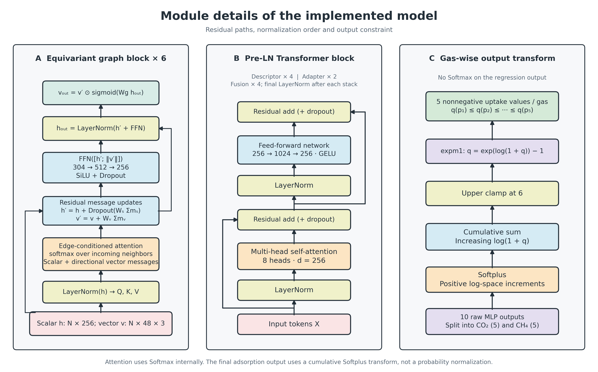

# 모델 아키텍처

전체 모델의 학습 파라미터 수는 14,536,691개입니다.
아래의 두 타워 파라미터 수는 조건 적응 모듈과 보조 출력 헤드를 제외한 값입니다.

## 구조 타워: 4,694,768 parameters

1. 원자번호를 119 × 256 임베딩 테이블로 변환합니다.
2. 연속 원자 특성 13개와 결측 마스크 13개를 연결해 26 → 256 → 256 MLP로 투영하고 원자 임베딩과 더합니다.
3. 간선 거리의 Gaussian RBF 64차원, 관계 임베딩 24차원, soft bond score 1개를 연결한 89차원 입력을 256차원으로 투영합니다.
4. 8-head scalar attention과 방향 벡터 메시지를 쓰는 등변성 그래프 블록을 6회 적용합니다. Scalar는 256, vector는 48 × 3입니다.
5. 학습형 질의 8개의 회전 불변 어텐션 풀링으로 8 × 256 구조 토큰을 만듭니다.

주기 이웃은 cutoff 6 Å, 원자당 최대 32개를 사용합니다. ALCHEMI는 이웃 검색을 수행하며,
soft bond score는 공유 결합 반지름 등을 이용한 계산상 사전 규칙입니다. 실험 결합 차수는 아닙니다.

국소 밀집도 r3/r6은 거리 가중 합 Σ exp[-(r/σ)²]로, σ = 3 또는 6 Å입니다.
반경 안의 원자 수를 단순히 세거나 부피로 나눈 물리 밀도와 구분합니다.

## 전역 기술자 타워: 3,182,848 parameters

30개 기하·물리화학 기술자를 각각 t_j = x_j w_j + b_j + e_j 형태의
256차원 토큰으로 변환합니다. 학습형 CLS 토큰 1개를 더해 31개 토큰을
4층 Pre-LN Transformer에 입력하고 스택 끝에 LayerNorm을 적용합니다.
8-head attention, FFN 1024차원, GELU, dropout 0.10을 사용합니다.
CLS 하나만 추출하는 구조가 아니라 31개를 모두 다음 단계로 전달합니다.
기술자 목록과 정의: [model_30_descriptor_columns.csv](model_30_descriptor_columns.csv).

## 기체·압력 조건

표준화한 log10 압력과 그 sin/cos 변환으로 만든 특성 5개를 MLP에 입력합니다.
기체별 분자량·운동학적 직경·분극률·사중극자 여부·임계온도·이심인자 6개도
별도 MLP로 처리하고 기체 ID 임베딩 및 조건별 임베딩과 더합니다.
그 결과 기체·압력 조건 10개에 대응하는 10 × 256 조건 토큰이 생성됩니다.

각 타워의 조건 적응 모듈은 [조건 토큰; 타워 토큰]을 연결해 2층 Transformer로
처리하고 앞의 조건 토큰 10개를 반환합니다. Decoder cross-attention이 아니라
결합 시퀀스에 대한 self-attention입니다.

## 융합과 출력

조건 정보를 더한 학습형 융합 질의 10개, 구조 조건 토큰 10개,
기술자 조건 토큰 10개에 유형 임베딩을 더해 총 30개 토큰을 구성합니다.
4층 Pre-LN Transformer와 최종 LayerNorm으로 처리하고 앞의 질의 토큰
10개를 선택합니다. 공유 MLP 256 → 256 → 1 (SiLU)로 raw 출력을 만듭니다.

융합 질의는 예측 조건별로 학습하는 벡터이며, 추론할 MOF의 정답 흡착량을
담은 입력 피처가 아닙니다. 정답은 학습 손실을 계산할 때 사용됩니다.

기체마다 5개 출력을 나눠 q = expm1(min(cumsum(softplus(raw)), 6))를 적용합니다.
기체 내 압력 증가에 따라 q가 감소하지 않습니다. 상한 때문에 값이 같아질 수
있으므로 엄밀하게는 단조 비감소 제약입니다. 출력은 Softmax 확률이 아닙니다.

각 타워의 보조 출력에도 같은 변환이 적용됩니다. 학습 중 융합 직전 타워 표현에
modality dropout 0.05를 적용합니다. 보조 헤드와 최종 융합 헤드는 공동 학습됩니다.

